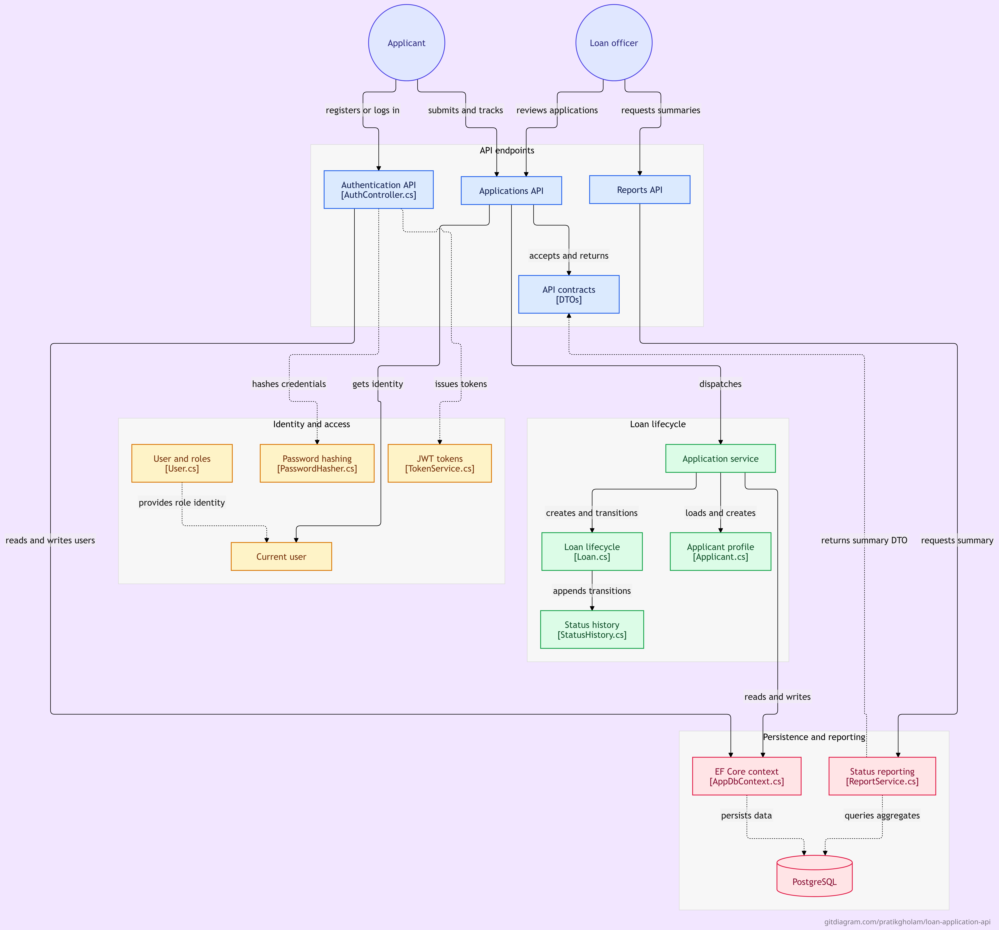

# Loan Application API

A REST API for submitting, reviewing, and tracking loan applications, built with ASP.NET Core (.NET 10), PostgreSQL, and RabbitMQ.

Applicants submit and track their applications. Loan officers review them and approve or reject. Every status change is recorded with the acting user, a timestamp, and an optional note, giving a complete audit trail. Each application declares a loan type when submitted, and a background worker assigns it to the officer whose expertise matches that type.

> **Note:** This is a portfolio project. All data is fictional, and the design is original. It contains no code, data, or design patterns from any employer.

## Features

- JWT authentication with role-based authorization (Applicant, LoanOfficer, Admin)
- Server-side ownership checks: applicants can only access their own applications
- Application lifecycle with an explicit status workflow
- Append-only status history for auditing
- Paged, filterable application listing
- Status summary report (count and total amount per status)
- Loan type on submission and automatic assignment to a matching officer through RabbitMQ
- EF Core for writes and general reads; Dapper with hand-written SQL for reporting
- Unit and integration tests (xUnit) against real PostgreSQL and RabbitMQ instances
- Containerized with Docker Compose; interactive API reference via Scalar

## Tech Stack

| Area | Technology |
|---|---|
| Framework | ASP.NET Core Web API (.NET 10) |
| Database | PostgreSQL |
| Messaging | RabbitMQ (publisher confirms, manual ack) |
| Data access | Entity Framework Core (Npgsql), Dapper |
| Auth | JWT bearer, role-based authorization |
| Testing | xUnit |
| Tooling | Docker, Docker Compose, Scalar |

## Application Workflow



Each transition is stored in the `StatusHistory` table with the user, timestamp, and an optional note.

## Roles and Permissions

| Role | Permissions |
|---|---|
| **Applicant** | Register, create a profile, submit applications, view and withdraw their own applications |
| **LoanOfficer** | View applications assigned to them, start review, approve or reject, view reports |
| **Admin** | All LoanOfficer permissions; sees all applications, assigned or not |

Authorization is enforced on the server. An applicant cannot read another applicant's application, even with a valid ID.

## API Reference

| Method | Route | Access | Description |
|---|---|---|---|
| POST | `/auth/register` | Public | Create an account |
| POST | `/auth/login` | Public | Authenticate and receive a JWT |
| POST | `/applications/profile` | Applicant | Create applicant profile |
| POST | `/applications` | Applicant | Submit an application (requires a loan type) |
| GET | `/applications/{id}` | Applicant (own), LoanOfficer, Admin | Get a single application, including the assigned officer |
| GET | `/applications` | LoanOfficer, Admin | List applications (officers see their assignments; status filter, paged) |
| POST | `/applications/{id}/start-review` | LoanOfficer, Admin | Move an application to review |
| POST | `/applications/{id}/review` | LoanOfficer, Admin | Approve or reject |
| POST | `/applications/{id}/withdraw` | Applicant (own) | Withdraw an application |
| GET | `/reports/status-summary` | LoanOfficer, Admin | Count and total amount per status |

Interactive documentation is available at `/scalar/v1` when the API is running.

## Data Model

| Entity | Description |
|---|---|
| `User` | Credentials, role, and (for officers) expertise |
| `Applicant` | Name, date of birth, monthly income |
| `Loan` | Amount, term, purpose, loan type, assigned officer, current status |
| `StatusHistory` | One record per status change |

## Design Decisions

**EF Core and Dapper together.** EF Core handles most reads and writes, with migrations managing the schema. The status summary report uses Dapper with plain SQL, since an aggregate query is clearer and easier to tune as SQL than as LINQ.

**Audit trail by design.** Status changes are never overwritten; each transition adds a row to `StatusHistory`.

**Concurrency protection.** `Loan.Status` is an EF Core concurrency token, so two conflicting status updates cannot both commit; the API returns 409 and asks the caller to reload.

**Integration tests on real PostgreSQL.** Database-backed tests run against PostgreSQL rather than an in-memory substitute, so behavior matches production.

**Direct publish, then a worker assigns.** After the loan is saved, the API publishes a `LoanSubmitted` message with publisher confirms and a bounded retry. A separate worker consumes one message at a time, assigns the matching officer, and acknowledges only after the assignment is saved. There is no transactional outbox: if publishing exhausts its retries or the API crashes between save and publish, the loan stays saved and unassigned. This is recorded in `docs/adr/0001-rabbitmq-loan-assignment.md`.

## Getting Started

### Prerequisites

- [Docker](https://docs.docker.com/get-docker/)
- [.NET 10 SDK](https://dotnet.microsoft.com/download/dotnet/10.0) (required for migrations and running tests)

### Run

```bash
git clone https://github.com/pratikgholam/loan-application-api.git
cd loan-application-api
docker compose up --build -d
```

The API is available at `http://localhost:8080`, with the Scalar reference at `http://localhost:8080/scalar/v1`. The RabbitMQ management UI is at `http://localhost:15672`.

Compose reads secrets from a gitignored `.env` at the repository root. Create it before starting:

```
POSTGRES_PASSWORD=<database password>
JWT_KEY=<at least 32 characters>
ASPNETCORE_ENVIRONMENT=Development
RABBITMQ_USER=<broker username>
RABBITMQ_PASSWORD=<broker password>
```

### Apply database migrations

Migrations apply automatically on API startup, so `docker compose up --build -d` alone creates the schema — no separate `dotnet ef database update` step is needed.

To apply migrations without starting the API (e.g. in CI), run:

```bash
dotnet ef database update \
  --project src/LoanApplication.Api \
  --startup-project src/LoanApplication.Api
```

### Run tests

```bash
# All tests (integration tests require Docker)
dotnet test

# Unit tests only (no Docker required)
dotnet test --filter "FullyQualifiedName!~IntegrationTests"
```

## Project Structure

```
loan-application-api/
├── src/
│   ├── LoanApplication.Api/      # Web API
│   └── LoanApplication.Worker/   # RabbitMQ consumer and assignment logic
├── tests/
│   └── LoanApplication.Tests/    # Unit and integration tests
├── docs/
│   ├── adr/                      # Architecture decision records
│   └── agents/                   # Agent-facing project docs
└── CHANGELOG.md
```

See `CHANGELOG.md` for release history.
